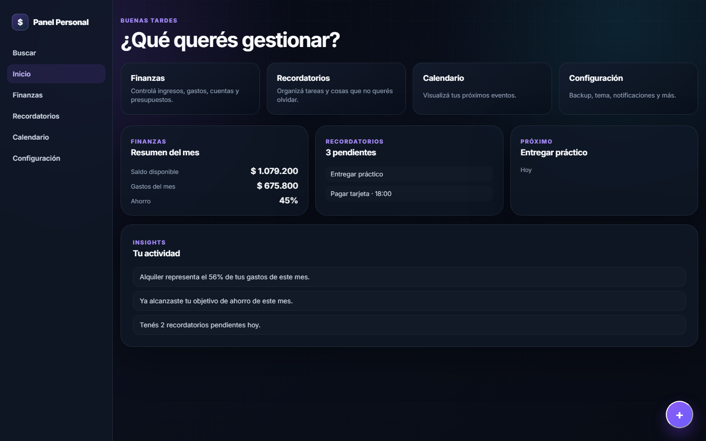
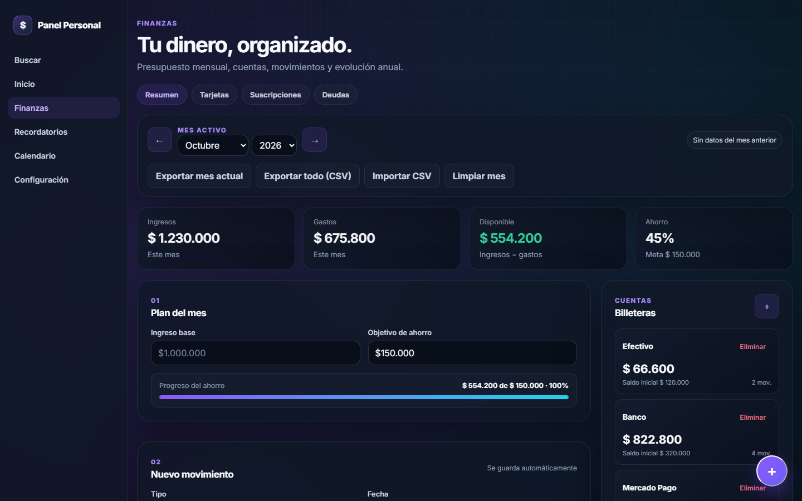

# Finanzas Personales

**Live demo:** https://finanzas-personales-xi-ashy.vercel.app

| Home · Inicio | Finances · Finanzas |
|---|---|
|  |  |

<sub>Screenshots use sample data · Las capturas usan datos de ejemplo</sub>

[English](#english) · [Español](#español)

---

## English

A personal finance and reminders app built with **plain JavaScript**: no framework, no build step.

### Features

- Income, expenses and transfers across multiple accounts (cash, bank, Mercado Pago)
- Monthly budgets by category
- Credit cards, subscriptions and debts tracking
- Reminders, calendar and due-date notifications
- CSV import and export
- Global search, quick-add and light/dark theme
- All data stays in the browser (localStorage), with versioned migrations from older formats

### How it's built

The app is a single page split into ES modules, with a small architecture written from scratch:

```
js/
  router.js      view router: shows/hides [data-view] sections, lazy init per view
  state.js       central store with subscribe/persist (observer pattern)
  storage.js     localStorage persistence + migration from previous schema versions
  modules/       one module per feature (finance, cards, debts, reminders, calendar...)
  components/    reusable UI pieces (toast, confirm dialog, quick-add)
  utils/         dates, currency formatting, DOM helpers, id generation
```

### Run locally

No install needed. Serve the folder with any static server:

```bash
npx serve .
```

### Tech

JavaScript (ES modules) · HTML · CSS · localStorage · Notifications API

---

## Español

App de finanzas personales y recordatorios hecha con **JavaScript puro**: sin frameworks y sin paso de build.

### Funcionalidades

- Ingresos, gastos y transferencias entre varias cuentas (efectivo, banco, Mercado Pago)
- Presupuestos mensuales por categoría
- Seguimiento de tarjetas de crédito, suscripciones y deudas
- Recordatorios, calendario y notificaciones de vencimientos
- Importación y exportación en CSV
- Búsqueda global, carga rápida y tema claro/oscuro
- Todos los datos quedan en el navegador (localStorage), con migraciones versionadas desde formatos anteriores

### Cómo está hecha

La app es una sola página dividida en ES modules, con una arquitectura chica escrita desde cero:

```
js/
  router.js      router de vistas: muestra/oculta secciones [data-view], inicializa cada vista al entrar
  state.js       store central con subscribe/persist (patrón observer)
  storage.js     persistencia en localStorage + migración desde versiones anteriores del esquema
  modules/       un módulo por funcionalidad (finanzas, tarjetas, deudas, recordatorios, calendario...)
  components/    piezas de interfaz reutilizables (toast, diálogo de confirmación, carga rápida)
  utils/         fechas, formato de moneda, helpers del DOM, generación de ids
```

### Cómo correrla

No hace falta instalar nada. Serví la carpeta con cualquier servidor estático:

```bash
npx serve .
```

### Tecnologías

JavaScript (ES modules) · HTML · CSS · localStorage · Notifications API
